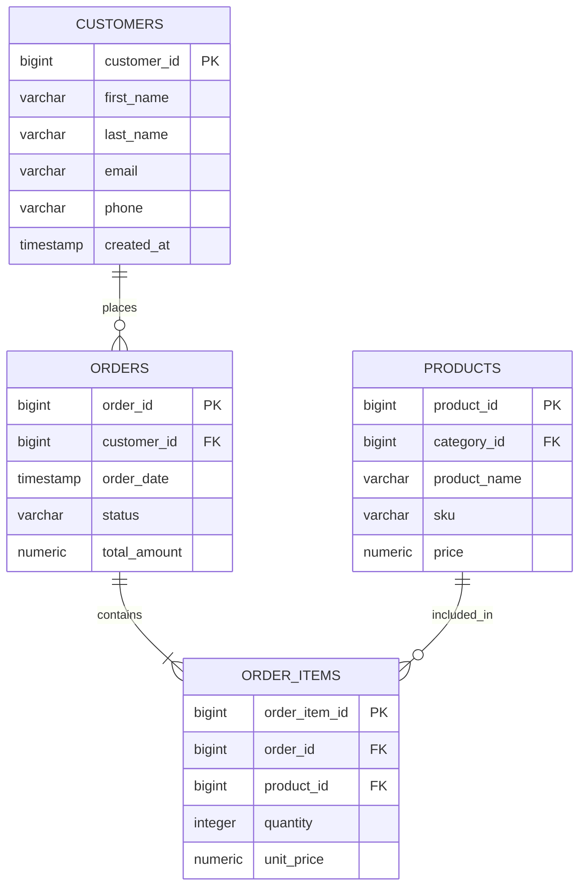

# NovaMart — Entity Relationship Design (ERD)

## 1. Project Overview

NovaMart is an e-commerce and retail intelligence platform designed to manage customers, products, orders, order items, inventory, payments, shipping, returns, and business analytics.

The database will be implemented using PostgreSQL.

This document describes the initial entity relationship design of the core order management system.

## 2. Core Entities

### 2.1 Customers

Stores customer account information.

| Attribute | Description |
|---|---|
| customer_id | Primary key identifying each customer |
| first_name | Customer's first name |
| last_name | Customer's last name |
| email | Customer email address |
| phone | Customer phone number |
| created_at | Account creation timestamp |

### 2.2 Orders

Stores customer order information.

| Attribute | Description |
|---|---|
| order_id | Primary key identifying each order |
| customer_id | Foreign key referencing customers |
| order_date | Date and time the order was placed |
| status | Order processing status |
| total_amount | Final order total |

### 2.3 Products

Stores product catalog information.

| Attribute | Description |
|---|---|
| product_id | Primary key identifying each product |
| category_id | Foreign key referencing product categories |
| product_name | Product name |
| sku | Unique stock keeping unit |
| price | Current product selling price |

### 2.4 Order Items

Stores individual products included in an order.

| Attribute | Description |
|---|---|
| order_item_id | Primary key identifying each order item |
| order_id | Foreign key referencing orders |
| product_id | Foreign key referencing products |
| quantity | Number of units purchased |
| unit_price | Selling price per unit at purchase time |

## 3. Primary Keys

| Entity | Primary Key |
|---|---|
| customers | customer_id |
| orders | order_id |
| products | product_id |
| order_items | order_item_id |

Each primary key uniquely identifies a record within its table.

## 4. Foreign Keys

| Table | Foreign Key | References |
|---|---|---|
| orders | customer_id | customers.customer_id |
| order_items | order_id | orders.order_id |
| order_items | product_id | products.product_id |
| products | category_id | categories.category_id (planned) |

Foreign keys maintain referential integrity between related tables.

## 5. Relationships

### Customers and Orders
- Relationship: One-to-many (1:N)
- One customer can place multiple orders.
- Each order belongs to one customer.
- Foreign key: orders.customer_id.

### Orders and Order Items
- Relationship: One-to-many (1:N)
- One order can contain multiple order items.
- Each order item belongs to one order.
- Foreign key: order_items.order_id.

### Products and Order Items
- Relationship: One-to-many (1:N)
- One product can appear in multiple order items.
- Each order item references one product.
- Foreign key: order_items.product_id.

### Orders and Products
- Relationship: Many-to-many (M:N)
- An order can contain multiple products.
- A product can be included in multiple orders.
- The relationship is resolved through the order_items junction table.

## 6. Business Rules

1. Each customer must have a unique customer identifier.
2. Each order must reference an existing customer.
3. Each product must have a unique product identifier.
4. Each order item must reference a valid order and product.
5. Order item quantity must be greater than zero.
6. Product prices must not be negative.
7. Historical order item prices must not change when the current product price changes.
8. A confirmed order must contain at least one order item.
9. Order totals must be consistent with the order items and applicable charges, discounts, and taxes.

## 7. ER Diagram

## 8. Design Decisions

- Surrogate primary keys are used to uniquely identify records.
- Orders are stored separately from customers.
- Order items are stored separately to support orders containing multiple products.
- The many-to-many relationship between orders and products is resolved through order_items.
- Unit price is captured at the time of purchase to preserve historical pricing.
- Order totals are retained as finalized business values and will be validated against the order calculation.

## 9. Future Database Modules

The complete NovaMart database will include:

- Customer addresses
- Product categories
- Suppliers and supplier-product relationships
- Reviews
- Payments
- Refunds
- Warehouses
- Inventory
- Shipments
- Shipment tracking history
- Returns

These modules will be designed and integrated in subsequent stages.

## 10. Status

Initial core ERD design completed.

Next stage: PostgreSQL schema development, including table creation, data types, primary keys, foreign keys, and constraints.
